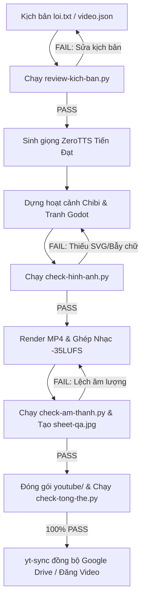

# Kỹ Năng: Kiểm Tra & Review Toàn Diện Video Tèo (`kiem-tra-video`)

Skill này thiết lập bộ lọc tiêu chuẩn chất lượng nghiêm ngặt (Quality Gate) cho toàn bộ quy trình sản xuất video của 2 kênh:
1. **Tèo Tửu Lâu** (Kiếm hiệp, phân tích nhân vật/võ công kinh điển).
2. **Lại Là Tèo Đây** (Lịch sử, văn hóa, danh nhân Việt Nam & thế giới).

---

## 🎯 CÁC TIÊU CHUẨN BẮT BUỘC (ZERO TOLERANCE)

1. **Thời lượng:**
   - **BẮT BUỘC $\ge 20$ PHÚT** (từ 1.200 giây trở lên, tối ưu 20–25 phút).
   - **TUYỆT ĐỐI KHÔNG LÀM SHORTS**. Kịch bản phải đạt $\ge 3.500$ từ.

2. **Kịch bản & Ngữ liệu:**
   - Phải có **Hook mở đầu ấn tượng** trong 3 câu đầu tiên (nêu mâu thuẫn, nghịch lý hoặc câu hỏi gây tò mò).
   - Phải có **Lời kêu gọi hành động (CTA)**: Like, bình luận quan điểm, đăng ký kênh ở phần kết.
   - Không chứa các từ xưng hô máy móc: "các bạn", "quý vị độc giả", "AI", "mô hình ngôn ngữ". Xưng hô chuẩn mực: Tèo - quý bằng hữu (kiếm hiệp) hoặc Tèo - quý vị/anh em.

3. **Hình ảnh & Hoạt cảnh (Chống bẫy Slide chữ tĩnh):**
   - **Dàn Chibi rig2:** Thư mục `godot/mat/` (hoặc `assets/svg/`) phải có đầy đủ biểu cảm SVG cho tất cả các nhân vật xuất hiện.
   - **Không làm PowerPoint:** Cảnh diễn hoạt bắt buộc phải có nhân vật Chibi xuất hiện (`Ng.ve` / `N.ve`), kết hợp các hiệu ứng động mềm mại (`sin`, `cos`, `lerp`, `tuyen_tinh`, `rung`, `xoay`, `alpha`). Cấm tuyệt đối cảnh chỉ vẽ màn đen và in dòng chữ tĩnh.
   - **Bảng soi QA:** Trích xuất 12 khung hình trải đều video thành Contact Sheet `sheet-qa.jpg` (lưới 4x3) để kiểm tra bố cục thị giác.
   - **Ảnh bìa (Thumbnail):** Độ phân giải 1280×720 (hoặc 1920×1080) tỷ lệ 16:9, dung lượng $< 2$ MB, rõ mặt nhân vật và chữ tiêu đề to dễ đọc trên điện thoại.

4. **Âm thanh chuẩn YouTube:**
   - Giọng đọc chính: **ZeroTTS Tiến Đạt** chuẩn hóa âm lượng xấp xỉ **-20.0 LUFS**.
   - Nhạc nền: Đạt mức $\le -35$ đến $-40$ LUFS (thấp hơn giọng $\ge 15$ dB, không lấn át lời dẫn).
   - True Peak $\le -0.5$ dBFS (tránh hoàn toàn hiện tượng rè loa, méo âm thanh).
   - Tắt sạch SFX giật mình, tiếng nổ đột ngột gây chói tai.

---

## 🛠️ CÔNG CỤ & SCRIPTS SỬ DỤNG

Tất cả scripts nằm tại: `__SKILLS_DIR__/kiem-tra-video/scripts/`

### 1. Kiểm tra toàn diện một chạm:
```bash
python3 __SKILLS_DIR__/kiem-tra-video/scripts/check-tong-the.py <đường_dẫn_thư_mục_tập>
```
*Tùy chọn: Thêm `--no-sheet` nếu muốn chạy siêu tốc bỏ qua trích xuất ảnh QA.*

### 2. Review kịch bản trước khi thu âm / render:
```bash
python3 __SKILLS_DIR__/kiem-tra-video/scripts/review-kich-ban.py <đường_dẫn_thư_mục_tập>
```### 2. Review kịch bản trước khi thu âm / render:

**Ưu tiên dùng reviewer đa engine v2** (HyperFrames `video.json` và Godot `loi.txt`):
```bash
python3 __SKILLS_DIR__/kiem-tra-video/scripts/review-kich-ban-v2.py <đường_dẫn_thư_mục_tập>
python3 __SKILLS_DIR__/kiem-tra-video/scripts/review-kich-ban-v2.py <đường_dẫn_thư_mục_tập> --json
```

Reviewer cũ vẫn được giữ để tương thích workflow hiện tại; PASS của reviewer cũ không thay thế biên tập nội dung. Quy trình biên tập chi tiết: `__SKILLS_DIR__/video-teo/SCRIPT-EDITORIAL-V2.md`.

```bash
python3 __SKILLS_DIR__/kiem-tra-video/scripts/review-kich-ban.py <đường_dẫn_thư_mục_tập>
```

### 3. Kiểm tra hình ảnh, Chibi & xuất Contact Sheet:
```bash
python3 __SKILLS_DIR__/kiem-tra-video/scripts/check-hinh-anh.py <đường_dẫn_thư_mục_tập>
```

### 4. Kiểm tra âm thanh LUFS & True Peak:
```bash
python3 __SKILLS_DIR__/kiem-tra-video/scripts/check-am-thanh.py <đường_dẫn_thư_mục_tập>
```

---

## 📋 QUY TRÌNH KIỂM SOÁT TRONG QUÁ TRÌNH TẠO VIDEO


